<div align="center">

# LIFT

**A personal training log, fast between sets.**

Log a set in one tap, see the plates on the bar, and find out whether you're getting stronger.
Works offline, installs on your phone and keeps your data on your device. In English or 简体中文.

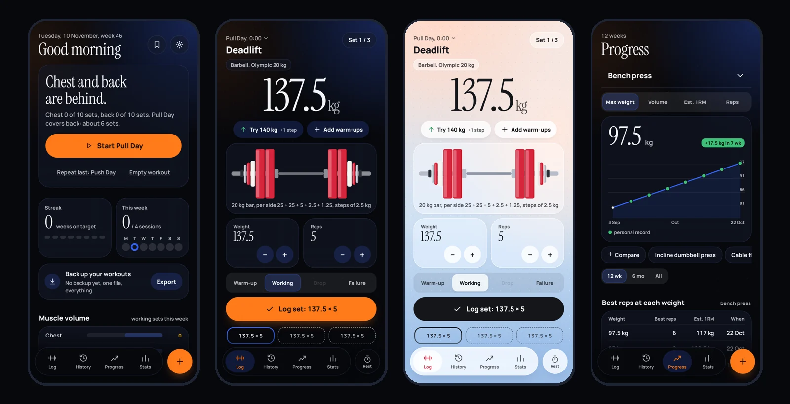

</div>

## Contents

- [What it does](#what-it-does)
- [Install it](#install-it)
- [First start](#first-start)
- [Walkthrough](#walkthrough)
  1. [Home](#1-home)
  2. [Start a workout](#2-start-a-workout)
  3. [Log a set](#3-log-a-set)
  4. [Rest and the rest-over alarm](#4-rest-and-the-rest-over-alarm)
  5. [During the workout](#5-during-the-workout)
  6. [Finish and save](#6-finish-and-save)
  7. [History](#7-history)
  8. [Progress](#8-progress)
  9. [Stats](#9-stats)
  10. [Templates, favourites and your own exercises](#10-templates-favourites-and-your-own-exercises)
  11. [Settings](#11-settings)
  12. [Backups and moving phones](#12-backups-and-moving-phones)
- [Gestures and shortcuts](#gestures-and-shortcuts)
- [More screenshots](#more-screenshots)
- [Run it yourself](#run-it-yourself)
- [How it's built](#how-its-built)

## What it does

**Logging**
- One-tap **Log set** with last time's numbers filled in, and a nudge to try the next step up
- The weight drawn as **plates on the bar, per side**, rebuilt live as you change it
- Seven log types: barbell, rack (dumbbells, kettlebells, plates), machine, bodyweight (plain, added or assisted), band, timed holds and cardio
- Swipe a machine's weight in its own steps (learned from your history), or tap the big number and type any weight
- Warm-up sets on their own row, working, drop and failure sets, supersets, notes on a set or pinned to an exercise
- A **rest timer** that starts by itself, and a full-screen **alarm** when rest is over: slide to lift, or snooze 30 seconds

**Progress**
- Personal records flagged as you lift
- Charts per exercise for max weight, volume, estimated 1RM and reps, and a best-reps-per-weight table
- Weekly sets per muscle against target ranges, push/pull and upper/lower balance, streaks
- 12-week trends, a tappable training calendar, a 1RM calculator and weekly bodyweight weigh-ins

**Your data**
- Everything stays on the phone; nothing is sent anywhere
- One-file backup export and import, including from the older LIFT 5
- Templates, favourites, custom exercises, and your gym's own bars, plates, dumbbells, machines and bands

**Comfort**
- English or Simplified Chinese; light, dark or follow-the-phone theme; "reduce glass" and a larger text size
- 56 px main buttons for one-handed use mid-set; keyboard focus rings; animations turn off with Reduce motion

## Install it

LIFT is a web app you install from the browser. Nothing goes through an app store.

1. Open the LIFT link on your phone: **Safari** on iPhone, **Chrome** on Android.
2. Install it:
   - iPhone: tap **Share**, then **Add to Home Screen**, then **Add**.
   - Android: tap **⋮**, then **Install app** (or **Add to Home screen**). Settings › App › **Install LIFT** does the same when Chrome offers it.
3. Open LIFT from the new icon on your home screen. From now on it works with no signal.

> **Your workouts live on this phone, in this browser.** Clearing the browser's website data, or deleting the app, deletes them. Export a backup now and then (see [Backups](#12-backups-and-moving-phones)); LIFT reminds you every 7 days.

## First start

<table><tr>
<td width="50%" valign="top">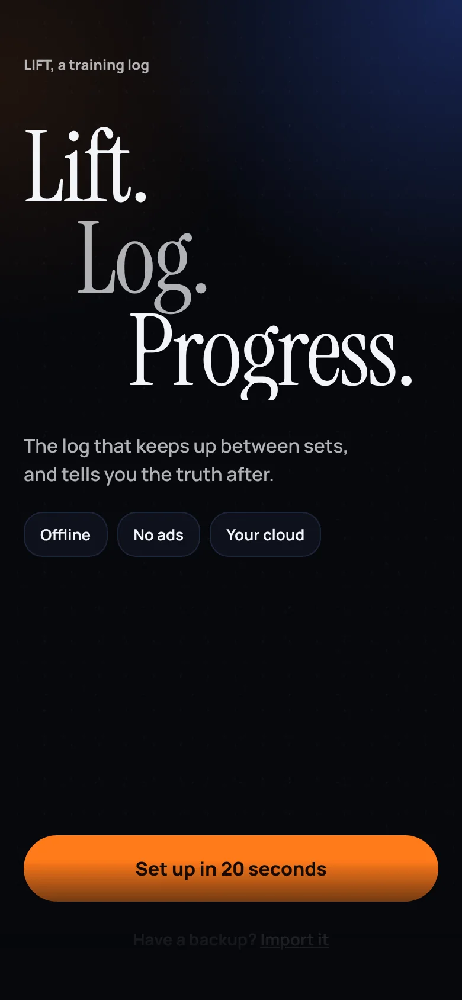</td>
<td valign="top">

The first time you open LIFT you see the welcome screen.

- **Set up in 20 seconds** asks for three things: your name (shown on Home), your **bodyweight** (used for pull-ups, dips and push-ups) and your usual **bar weight** (20 or 15 kg). You can also pick the theme and the **language** (English or 简体中文) here.
- **Have a backup? Import it** brings in a LIFT 2 backup file, or old LIFT 5 data found on this phone. See [Backups](#12-backups-and-moving-phones).

Everything you pick here can be changed later in Settings.

</td></tr></table>

## Walkthrough

### 1. Home

<table><tr>
<td width="50%" valign="top">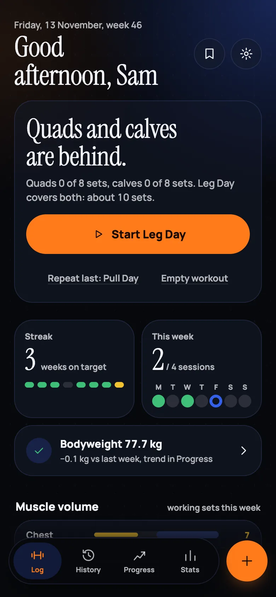</td>
<td valign="top">

Home is the **Log** tab when no workout is running. From top to bottom:

- **The focus card** names the muscles that are behind on this week's sets and offers the template that trains them most: tap **Start Leg Day** (for example). Below it: **Repeat last** and **Empty workout**.
- **Streak**: weeks in a row you hit your weekly target. **This week**: sessions so far against the target, with a dot per day.
- **Weekly weigh-in**: once a week a strip appears; swipe to your weight and tap **Log**. After that the card shows the change against last week; tap it for the chart.
- **Muscle volume**: working sets per muscle this week. The green band is the target range (Settings › Training).
- **Latest PR** and **Slipping** (lifts you haven't done for a while) when there is something to show.
- Top right: the **bookmark** opens Templates, the **gear** opens Settings.

The round **+** button at the bottom right always starts a workout.

</td></tr></table>

### 2. Start a workout

<table><tr>
<td width="50%" valign="top">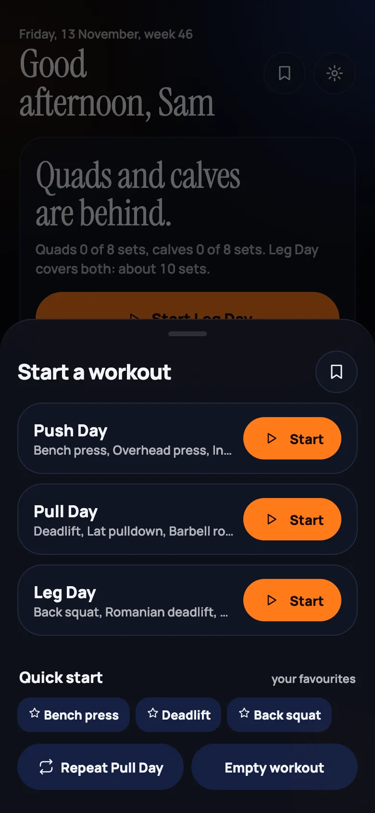</td>
<td valign="top">

Tap **+** to open **Start a workout**:

- **Templates**: tap **Start** on Push Day, Pull Day, or any template you saved. The sets and reps come along, filled with last time's numbers.
- **Quick start**: one tap starts a workout with that favourite exercise.
- **Repeat** the last workout, or start an **Empty workout** and add exercises as you go.
- The bookmark at the top of the sheet opens **Manage templates**.

Only one workout runs at a time. It saves as you go, so closing the app or a flat battery loses nothing.

</td></tr></table>

### 3. Log a set

<table><tr>
<td width="50%" valign="top">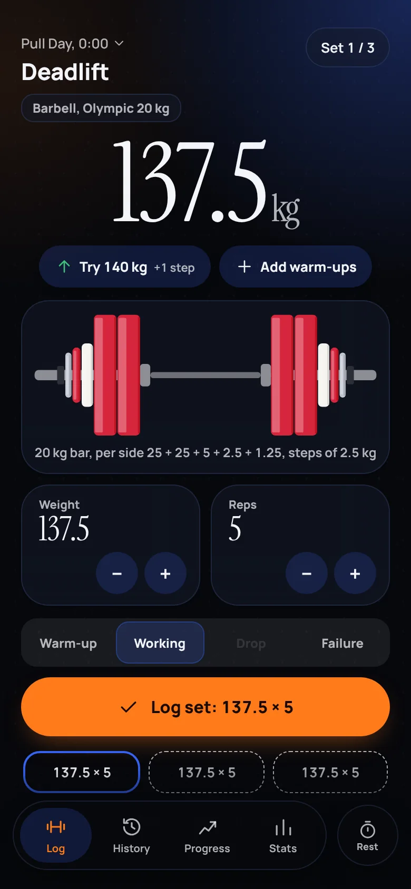</td>
<td valign="top">

This is where you spend the workout. Top to bottom:

- **Workout name and time** (tap for the [overview](#5-during-the-workout)). **Set 2 / 4** shows where you are.
- **Exercise name** (tap for [exercise options](#5-during-the-workout)) and the equipment chip.
- **The big weight.** Tap it to type any weight. Under it, **last 87.5 × 6** (tap to see the last three sessions) and a hint: **same as last time**, or **Try 90 kg +1 step** when you beat your reps last time (tap it to use it).
- **The picture** shows how to load it: plates per side on the bar, the pin on a weight stack, the dumbbell, the band.
- **Weight and Reps steppers**: tap − / + (hold to repeat). Machines and racks use a swipe strip in their own steps instead.
- **Set type**: Warm-up, Working, Drop, Failure.
- **Log set: 87.5 × 6** saves the set, buzzes, and starts the rest timer. An **Undo** shows for a few seconds.
- **Set tiles** along the bottom: done sets are solid, the current one is outlined, planned ones are dashed. Tap a tile to go to it or edit it; **press and hold** a planned set to remove it; **+** adds a set any time. Warm-ups get their own row above.

**Swipe left or right** on the screen to move to the next or previous exercise.

</td></tr></table>

Each log type shows what it needs:

| Log type | You enter | Notes |
|---|---|---|
| Barbell | weight, reps | Plates per side are worked out from your bar and plate set |
| Rack | weight, reps | Dumbbells (each hand), kettlebells or a single plate; swipe your rack's real weights |
| Machine | weight, reps | Weight stack (swipe the pin) or plate-loaded (sled + plates) |
| Bodyweight | reps, and added or assisted kg | Plain, + weight (belt or vest) or assisted (band or machine) |
| Band | band, reps | Pick the band colour; one side at a time logs left and right |
| Timed | seconds | **Start hold** counts up; stop to log, or type the time |
| Cardio | time, distance, level | Pace and speed are worked out; rate how it felt |

### 4. Rest and the rest-over alarm

<table><tr>
<td width="50%" valign="top">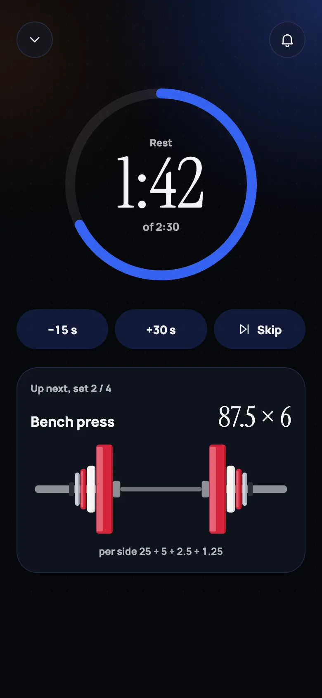</td>
<td width="50%" valign="top">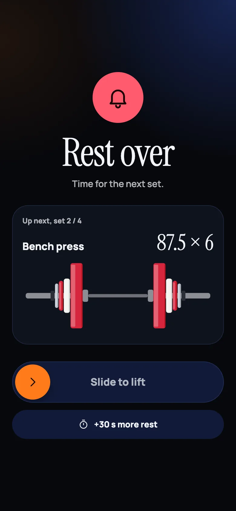</td>
</tr></table>

- Rest starts by itself when you log a set. The **Rest** button in the tab bar counts down; tap it for the big timer with **−15 s**, **+30 s** and **Skip**, and a preview of the next set.
- When the time is up, LIFT rings and vibrates and shows **Rest over** full screen. To get back to lifting, **slide the knob to the right**, or **press and hold** it, or press **Enter** on a keyboard. **+30 s more rest** snoozes.
- If the phone was locked, the alarm says how long ago rest ended.
- Rest length comes from Settings (one default, or per exercise: big lifts 2:30, compounds 2:00, isolation 1:30, bodyweight 1:00), and each exercise can have its own in exercise options. Drop sets have no rest.

### 5. During the workout

<table><tr>
<td width="50%" valign="top">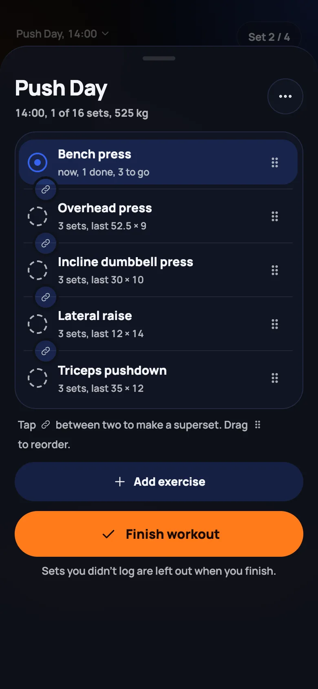</td>
<td width="50%" valign="top">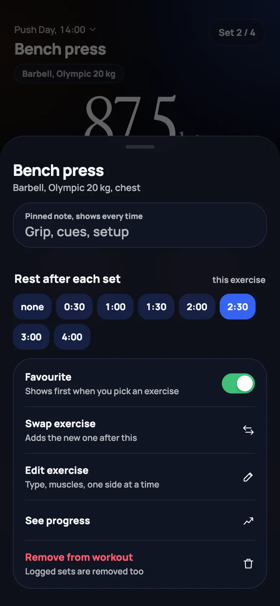</td>
</tr></table>

**Workout overview** (tap the workout name at the top):
- Every exercise with its sets; tap one to jump to it.
- Tap the **link** icon between two exercises to make a **superset**: LIFT goes straight from one to the other with no rest in between.
- **Drag** the handle to reorder. **Add exercise** and **Finish workout** are at the bottom.
- The **⋯** menu has a note for the session, **Save as template**, and **Discard workout**.

**Exercise options** (tap the exercise name):
- A **pinned note** that shows every time (grip, cues), and **seat and pad settings** for machines.
- **Weight step** for this machine, and **rest after each set** for this exercise.
- **Favourite** on or off.
- **Swap exercise** (keeps the planned sets), **Edit exercise**, **See progress**, **Remove from workout**.

**Adding an exercise**: tap **Add exercise** in the overview. The library opens on your **Favourites** and **Recent**, with chips for each muscle group and a search box. The **star** on each row adds or removes a favourite. Can't find it? Type the name and tap **Create** to make your own (see [section 10](#10-templates-favourites-and-your-own-exercises)).

<p align="center">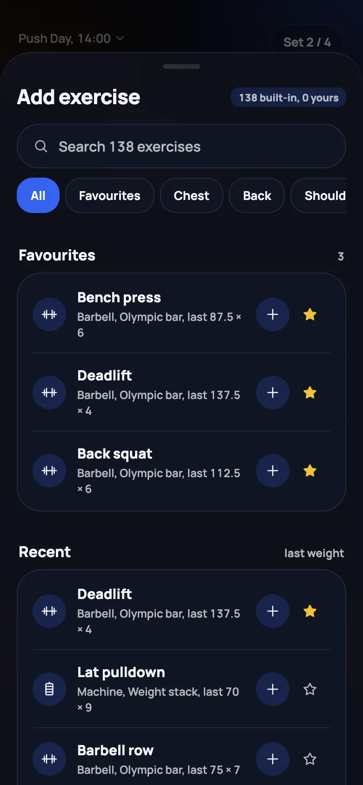</p>

### 6. Finish and save

<table><tr>
<td width="50%" valign="top">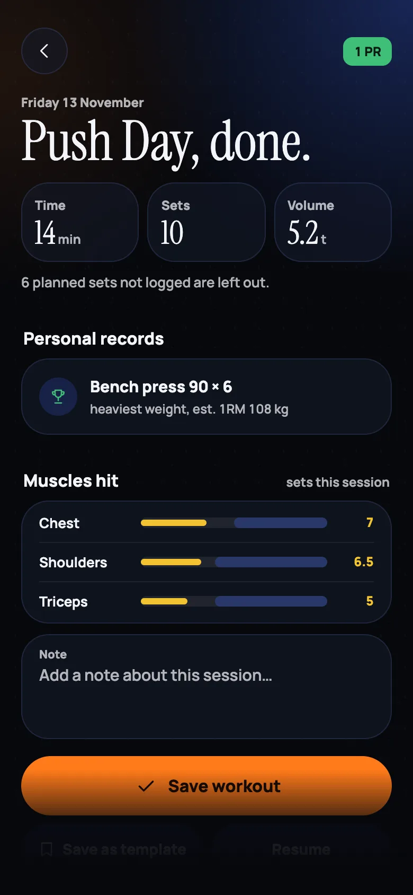</td>
<td valign="top">

Open the overview and tap **Finish workout**. The summary shows:

- **Time, sets and volume** (in tonnes).
- **Personal records** you set, and what kind: heaviest weight, most reps at a weight, best single-set volume, longest hold.
- **Muscles hit**: sets per muscle this session.
- A **note** box for how it went.

Tap **Save workout**. Planned sets you didn't log are left out. **Save as template** keeps this workout's exercises and set counts for next time; **Resume** goes back to logging.

</td></tr></table>

### 7. History

<table><tr>
<td width="50%" valign="top">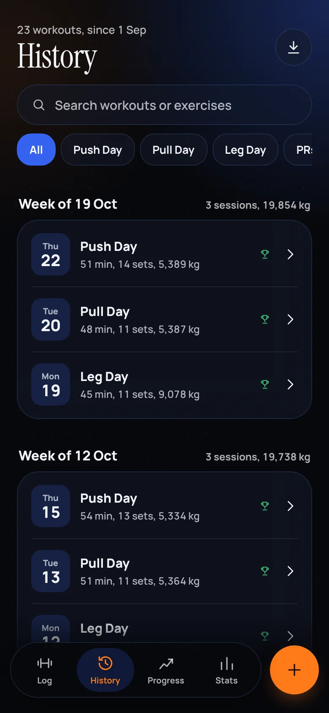</td>
<td valign="top">

The **History** tab lists every workout, newest first, grouped by week with the week's sessions and volume.

- **Search** for a workout or an exercise; the chips filter by workout name or PRs only.
- A trophy marks workouts with a PR.
- Tap a workout to see every set. There, **tap any set to change it**, or use **Repeat this workout**, **Save as template** or **Delete workout**.
- The download icon at the top exports a backup.

</td></tr></table>

### 8. Progress

<table><tr>
<td width="50%" valign="top">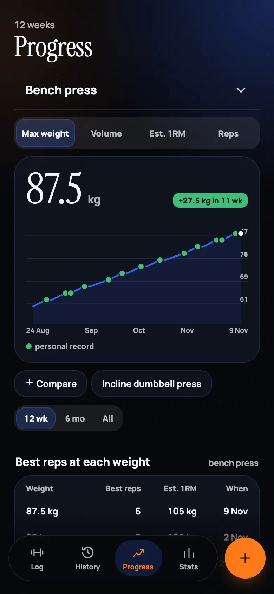</td>
<td valign="top">

The **Progress** tab charts one exercise at a time.

- Tap the exercise name to pick another, or **Bodyweight** for your weigh-in line.
- Measures: **Max weight**, **Volume**, **Est. 1RM**, **Reps** (timed and cardio exercises show hold time, distance and pace instead).
- The big number is your latest best and the change over the range; green dots are personal records.
- **Compare** puts a second exercise on the same chart. Ranges: **12 wk**, **6 mo**, **All**.
- **Best reps at each weight** lists your best set at every weight, with its estimated 1RM and date.

</td></tr></table>

### 9. Stats

<table><tr>
<td width="50%" valign="top">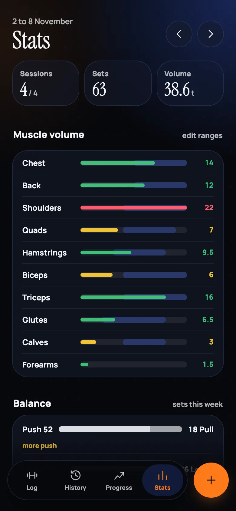</td>
<td width="50%" valign="top">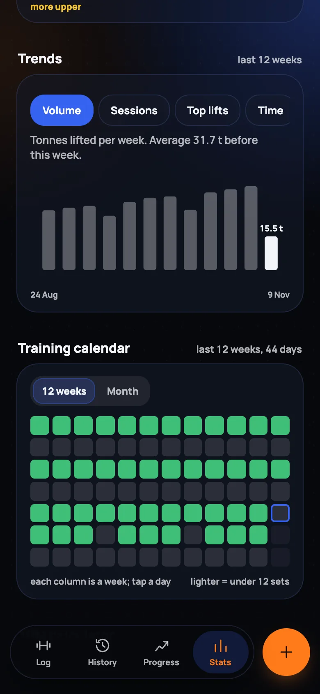</td>
</tr></table>

The **Stats** tab shows one week at a time; use the arrows at the top to go back.

- **Sessions, sets and volume** for the week.
- **Muscle volume**: working sets per muscle against its range. Below the first number the muscle is behind, above the second it's too much. Secondary muscles count half a set. **edit ranges** changes them.
- **Balance**: push against pull, upper against lower.
- **Trends** over 12 weeks: **Volume**, **Sessions** (against your target), **Top lifts** (estimated 1RM of your main lifts), **Time**, and **PRs** per month.
- **Training calendar**: 12 weeks or month by month; darker means more sets. **Tap a day** to see what you did and open the workout.
- **1RM calculator**: enter a weight and reps to get an estimated one-rep max and a percentage table (Epley or Brzycki, set in Settings). It's an estimate, never counted as a PR.

### 10. Templates, favourites and your own exercises

- **Templates** (bookmark icon on Home, or Manage templates): **+** makes a new one; add exercises, set **sets × target reps**, reorder, rename, delete. Any finished workout can become a template from its summary or from History.
- **Favourites**: tap the **star** in the library or switch on **Favourite** in exercise options. Favourites come first in the library and appear as **Quick start** buttons on the start sheet.
- **Your own exercise**: in the library type a name and tap **Create**, or tap **Can't find it?**. Pick **how it's logged** (one of the seven types), the **group** it sits in, the **main muscle** (counts for weekly volume) and **also works** (counts half). Options: one side at a time, a pair (one in each hand), log distance (carries), and a pinned note. Built-in exercises can be edited the same way, and **Reset to built-in** undoes it.

### 11. Settings

<table><tr>
<td width="50%" valign="top">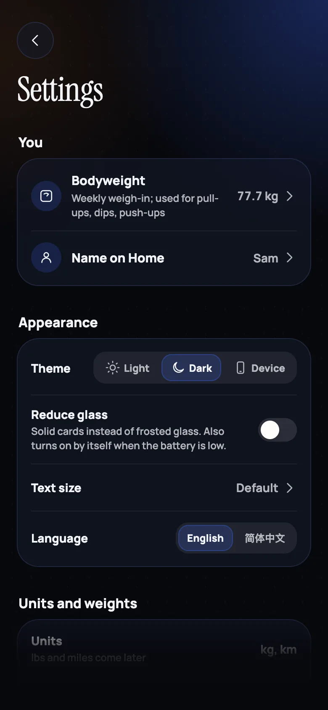</td>
<td valign="top">

Open with the gear on Home.

- **You**: bodyweight and the name on Home.
- **Appearance**: theme (Light, Dark, Device), **Reduce glass**, text size, and **Language**: English or **简体中文**.
- **Units and weights**: **Weight steps** (how much each − / + adds for barbells, dumbbells, stacks, machines) and **Equipment**: your bars, plates (tap to turn off ones your gym doesn't have), dumbbell rack, kettlebells, machines (stack size or sled weight) and bands.
- **Logging**: fill in last time's numbers, warm-up suggestions, drop-set size, RPE, PR alerts, haptics, keep the screen awake.
- **Rest timer**: default rest, different rest per exercise, sound, vibration.
- **Training**: weekly target, first day of the week, muscle volume ranges, 1RM formula.
- **Reminders**, **Sync and data** (export, import, clear all data) and **App** (install, version).

</td></tr></table>

**Chinese (简体中文).** Settings › Appearance › Language › **简体中文** switches every screen, button, message and date at once (for example 第 2/3 组, 11月13日 星期五). The 138 built-in exercises get Chinese names. Names you typed yourself (custom exercises, templates, notes) stay as you wrote them. To switch back, tap **English**.

<table><tr>
<td width="33%">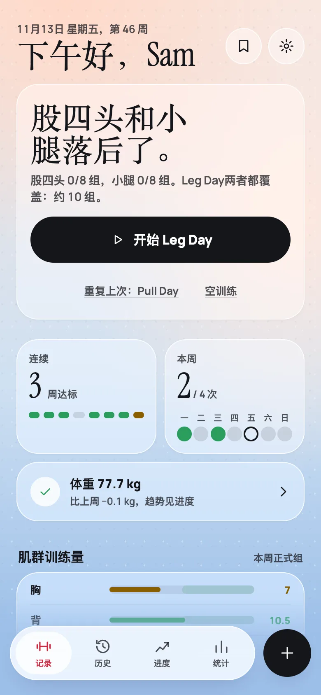</td>
<td width="33%">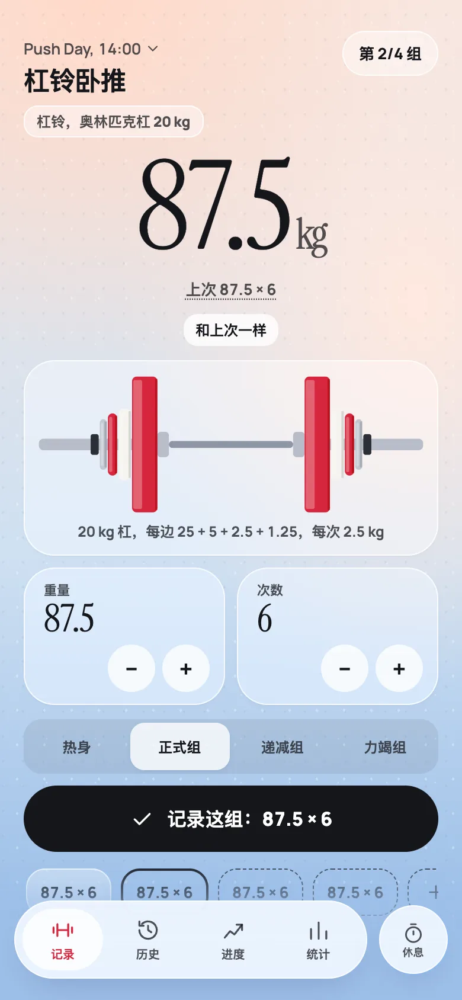</td>
<td width="33%">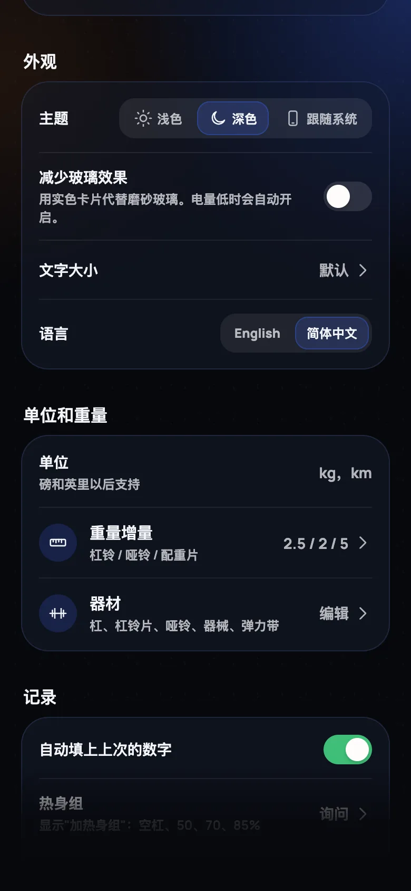</td>
</tr></table>

### 12. Backups and moving phones

- **Export**: Settings › Sync and data › **Export backup** (or the download icon in History) saves one `.json` file with everything: workouts, templates, custom exercises, weigh-ins and settings. Keep it somewhere safe, like your cloud drive.
- **Import**: Settings › **Import backup**, then pick the file. LIFT shows what will come in before anything changes. It **merges**: workouts already here stay, duplicates are skipped, and workouts you deleted on the phone come back from the file. Old LIFT 5 backups work too; exercise names LIFT doesn't know get a review step where you match each one to a built-in exercise or keep it as your own.
- **New phone**: export on the old phone, send the file to yourself, install LIFT on the new phone, and choose **Import it** on the welcome screen.
- **Clear all data** asks twice and saves a backup first.

## Gestures and shortcuts

| Where | Do this | It does |
|---|---|---|
| Log screen | Swipe left / right | Next / previous exercise |
| Log screen | Tap the big weight | Type any weight |
| Log screen | Tap **last …** | The last three sessions of this exercise |
| Steppers | Press and hold − / + | Repeats quickly |
| Set tiles | Tap / press and hold / **+** | Go to or edit / remove a planned set / add a set |
| Rest over | Slide, press and hold, or Enter | Back to lifting |
| Overview | Drag the handle / tap the link | Reorder / make a superset |
| Library | Tap the star | Favourite on or off |
| Stats calendar | Tap a day | What you did that day |

## More screenshots

All screenshots use made-up sample data (a lifter called Sam), not real training history.

| Home | Log a set | Rest | Rest over |
| :---: | :---: | :---: | :---: |
| 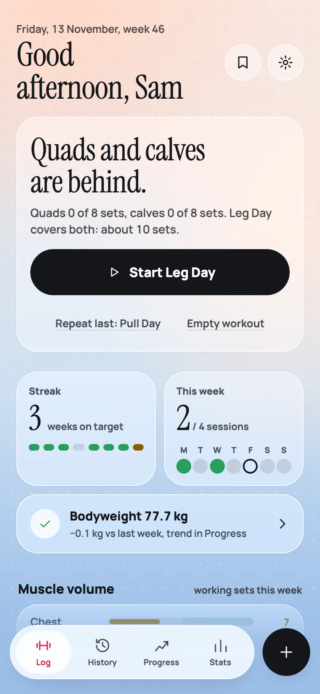 | 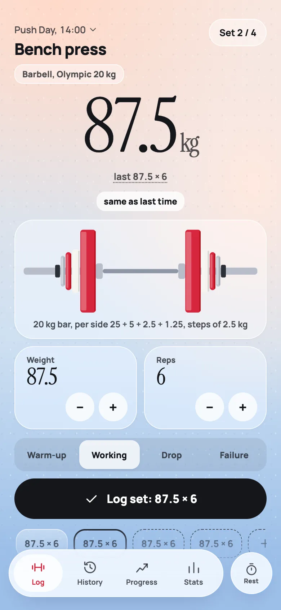 | 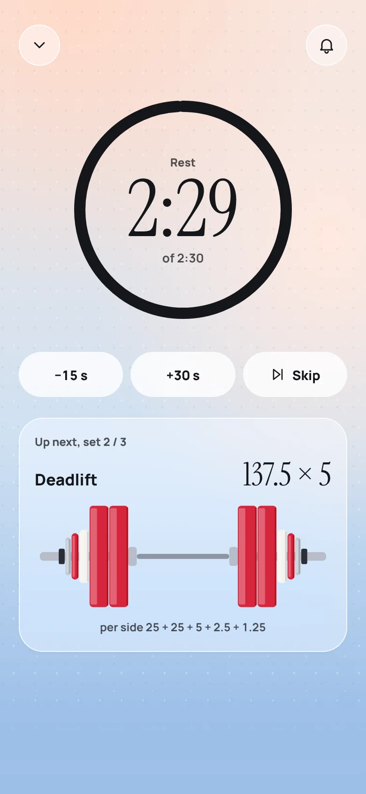 | 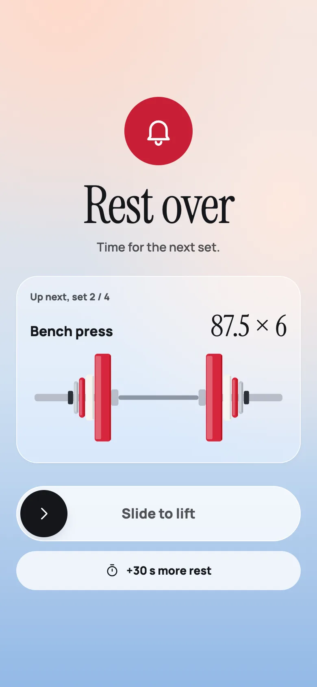 |
| **Overview** | **Exercise options** | **Library** | **Finish** |
| 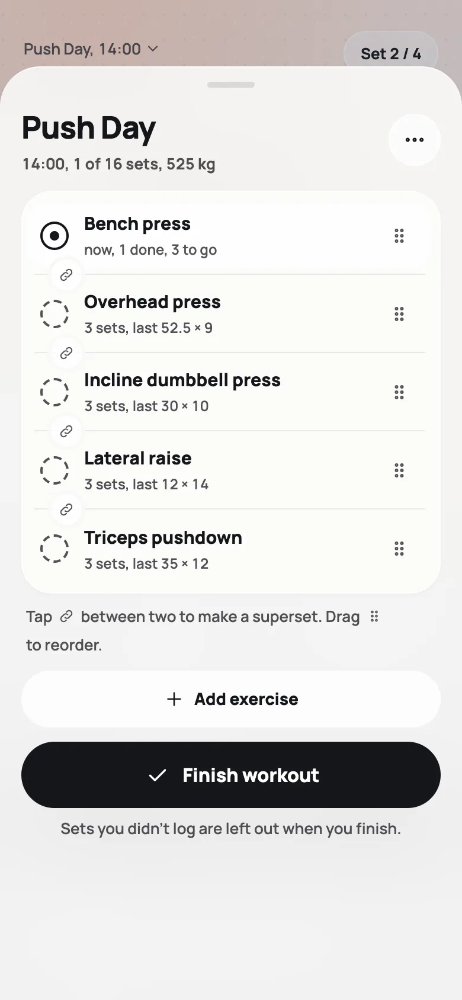 | 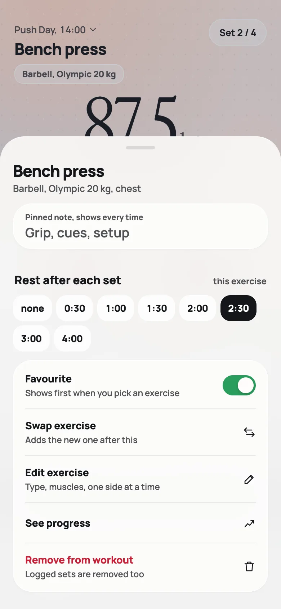 | 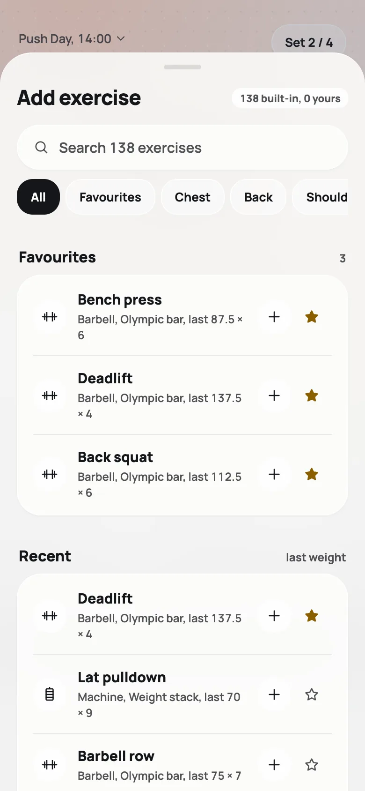 | 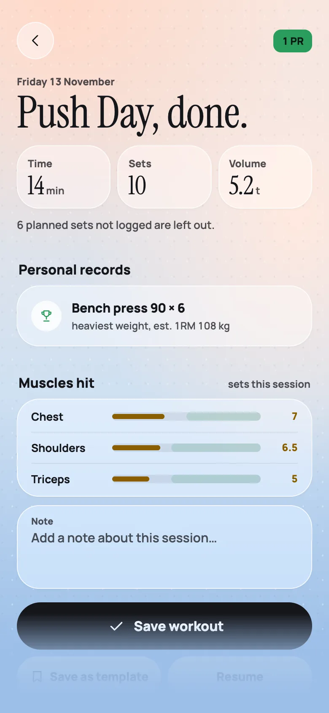 |
| **History** | **Progress** | **Stats** | **Trends** |
| 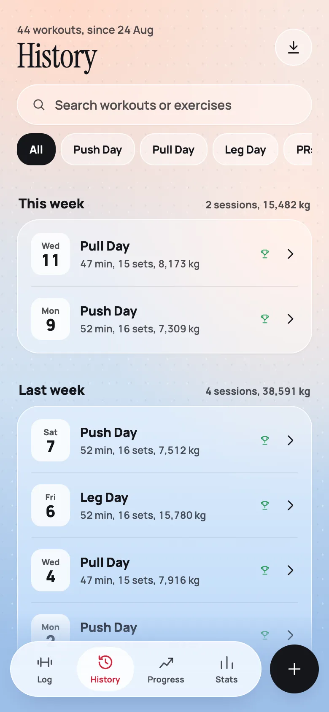 | 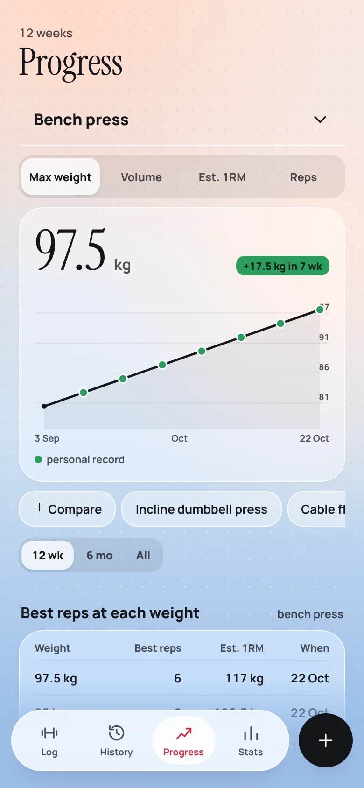 | 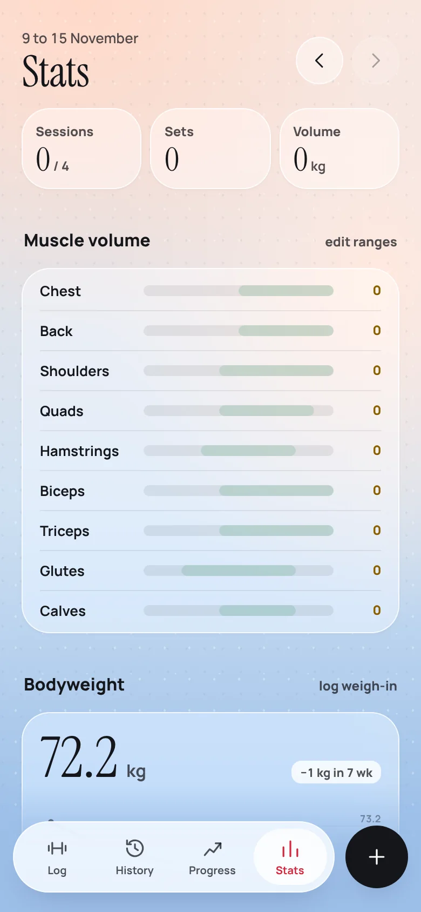 | 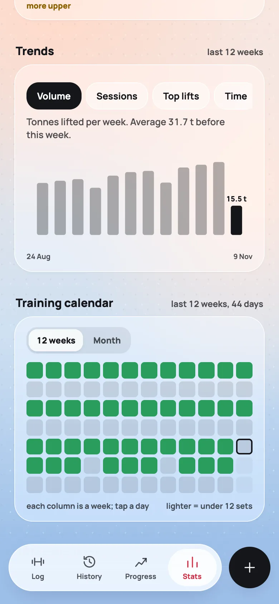 |
| **Start** | **Settings** | | |
| 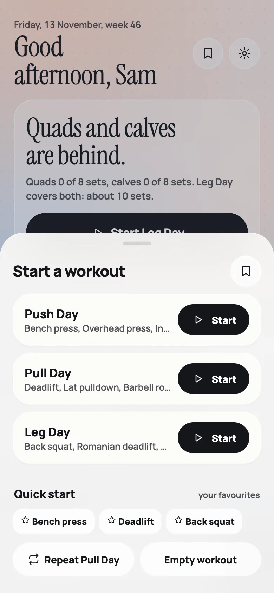 | 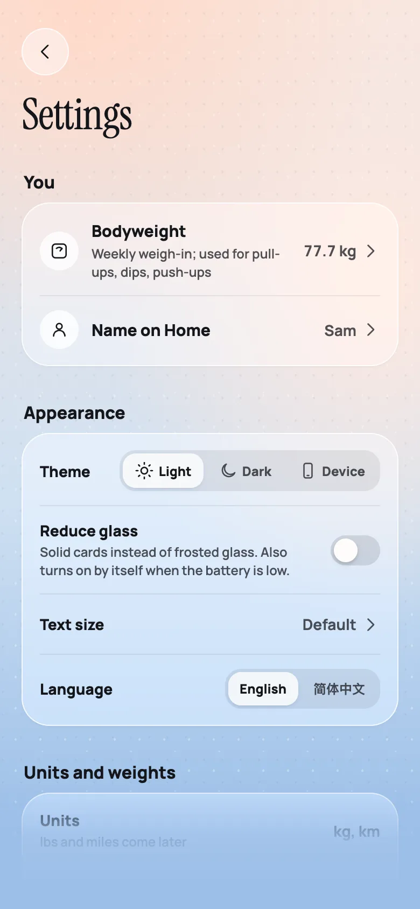 | | |

## Run it yourself

LIFT is plain HTML, CSS and JavaScript with no build step and no dependencies. Serve the folder with any static server:

```bash
python3 -m http.server 8000
```

Then open http://localhost:8000. To host it, upload these files to GitHub Pages or Cloudflare Pages. All paths are relative, so it also works from a sub-folder.

After changing any file, bump `VERSION` in `sw.js` so installed copies pick up the update.

To test, from the source folder (the tests are not part of the published app; Node 22+, and the browser tests also need Google Chrome and use made-up sample data):

```bash
node tests/run.js && node tests/sw-check.js
```

```bash
node tests/e2e/scenarios.js
```

```bash
sh tests/e2e/crawl-all.sh
```

`run.js` checks the logic and storage, `sw-check.js` the offline cache, `scenarios.js` walks through every feature in English and Chinese and checks what gets saved, and `crawl-all.sh` presses every button on every screen in both languages, reporting crashes and any English left in the Chinese version.

## How it's built

| File | Role |
| --- | --- |
| `index.html` | The page shell and the icon set |
| `app.css` | Base styles and design tokens |
| `unslop.css`, `motion.css`, `theme.css` | Design polish, motion, and the dark palette |
| `js/i18n.js` | Simplified Chinese: translates the screen as it renders |
| `js/store.js` | All storage (localStorage, `lift2_` keys) |
| `js/lift.js` | Logic: plate maths, PRs, volume, imports |
| `js/ui-core.js`, `js/ui-log.js`, `js/ui-views.js` | Rendering, the Log screen, and every other screen |
| `js/motion.js`, `js/unslop.js` | Transitions, feedback animations and loading states |
| `data/exercises.js` | The built-in exercise library |
| `sw.js`, `manifest.webmanifest` | Offline support and installation |

## Credits

- Fonts: Manrope and Instrument Serif, both under the SIL Open Font License (see `fonts/OFL.txt`).
- Plate colours follow Olympic competition bumper plates.
